# NGOConnect

> **Enterprise-Grade Community Food Redistribution, Volunteer Coordination & Impact Verification Platform**

[](https://www.oracle.com/java/)
[](https://spring.io/projects/spring-boot)
[](https://react.dev/)
[](https://vitejs.dev/)
[](https://tailwindcss.com/)
[](https://www.mysql.com/)
[](https://www.docker.com/)

---

## Live Deployments & Repository Links

-  **Production Web Application (Vercel)**: [https://ngoconnect-frontend.vercel.app](https://ngoconnect-frontend.vercel.app)
-  **Production REST API (Render)**: [https://ngoconnect-m2aq.onrender.com](https://ngoconnect-m2aq.onrender.com)
- **GitHub Repository**: [https://github.com/gauravto312-wq/ngoconnect](https://github.com/gauravto312-wq/ngoconnect)

---

## Table of Contents

- [Problem Statement & Overview](#problem-statement--overview)
- [Role-Based Feature Matrix](#role-based-feature-matrix)
- [System Architecture](#system-architecture)
- [Application Screenshots & Interface Walkthrough](#application-screenshots--interface-walkthrough)
- [Technology Stack](#technology-stack)
- [Security Architecture & Access Control](#security-architecture--access-control)
- [Cloudinary Media & Document Storage](#cloudinary-media--document-storage)
- [Local Installation & Setup](#local-installation--setup)
- [Environment Variables Configuration](#environment-variables-configuration)
- [Automated Testing & Production Build](#automated-testing--production-build)
- [Containerization & Cloud Deployment](#containerization--cloud-deployment)
- [Repository Directory Structure](#repository-directory-structure)
- [Contributing](#contributing)
- [License Status](#license-status)
- [Social Impact & Vision](#social-impact--vision)

---

## Problem Statement & Overview

Millions of tons of edible food are discarded daily by households, restaurants, and catering services, while local charities and relief centers face continuous supply shortages. The primary bottleneck is rarely food availability -- it is the **lack of rapid, verifiable, and transparent logistics** connecting surplus food producers with non-governmental organizations (NGOs) and community volunteers.

**NGOConnect** addresses this logistical barrier by providing a centralized, role-based platform that coordinates the entire food rescue lifecycle:

1. **Surplus Food Publication**: Citizens and restaurants list excess food with dietary details, portion sizes, expiry windows, and pickup addresses.
2. **On-Demand NGO Claiming**: Verified NGOs browse listings in real time and claim surplus food batches for local redistribution.
3. **Volunteer Logistics & Verification**: NGOs dispatch pickup and delivery tasks to volunteers, tracked by a secure **two-stage verification code system** (donor pickup verification and recipient handover verification).
4. **Community Food Drives**: NGOs schedule and execute meal distribution drives with evidence photo uploads, volunteer rosters, and progress metrics.
5. **Verified Governance**: Strict administrative auditing of NGO and restaurant documentation ensures that charitable contributions and food distributions remain compliant and trustworthy.

---

## Role-Based Feature Matrix

NGOConnect enforces a strict multi-tenant Role-Based Access Control (RBAC) model across five user personas:

### 1. Citizen (Donor)
- **Donation Publishing**: Create food donation listings with item titles, food types, portion quantities, expiry timestamps, pickup addresses, dietary flags, and food photos.
- **Marketplace Browsing**: View public food listings and monitor the progress of personal donations from listed to claimed to completed.
- **Community Drives**: Discover scheduled community food distribution drives and register as attendees or supporters.
- **Discovery**: Search and explore verified local NGOs and partner restaurants.
- **In-App Notifications**: Receive real-time alerts with unread badge counters when donations are claimed, scheduled, or delivered.

### 🏢 2. NGO (Non-Governmental Organization)
- **Marketplace Claiming**: Claim surplus meals posted by citizens and partner restaurants.
- **Volunteer Task Dispatch**: Generate delivery assignments with pickup/dropoff checkpoints, delivery instructions, and optional stipends.
- **Food Drive Orchestration**: Organize public food drives, manage attendee participant rosters, track distribution milestones, and publish post-event evidence photos.
- **Organization Verification**: Upload official documentation (e.g., 80G, 12A, NGO Darpan, or registration certificates) to secure private storage for administrative review.
- **Public Profile & Inquiries**: Maintain a public NGO landing page with a photo gallery and receive direct community inquiries.

### 🍽️ 3. Restaurant
- **Surplus Food Batches**: Publish large-batch surplus food items with specific pickup timeframes, portion estimates, and handling notes.
- **Multi-Branch Management**: Register and configure distinct branch locations, each with localized addresses, contact points, and operating hours.
- **Volunteer Coordination**: Review scheduled volunteer pickups, monitor dispatch timelines, and track historical donations across branches.
- **Public Restaurant Profile**: Present verified culinary sustainability initiatives and community support history to the public.

### 4. Volunteer
- **Task Discovery**: Browse available delivery tasks filtered by location proximity, timeline urgency, and offered stipends.
- **Two-Stage Verification Handover**:
  - **Pickup Code**: Input donor-provided security codes upon taking custody of meals.
  - **Handover Code**: Present or submit recipient codes upon final delivery to prevent fraudulent claims.
- **Activity & Earnings Tracking**: Monitor delivery run histories, completed task milestones, and accumulated stipend balances.
- **Event Participation**: Sign up to assist on-ground operations during community food drives.

###  5. Administrator
- **Verification Audit**: Review pending legal credentials from NGOs and restaurants, with capabilities to approve, reject, or request revisions alongside audit remarks.
- **Secure Document Inspection**: Access confidential verification files using short-lived (5-minute) cryptographically signed Cloudinary URLs.
- **User Account Management**: Activate or suspend citizen, volunteer, NGO, or restaurant accounts across the platform.
- **Dispute Resolution & Inquiries**: Investigate volunteer payment disputes and inspect public contact form submissions.
- **System Metrics**: Review aggregate platform indicators including donation volume, active listings, and completed food drives.

---

## System Architecture

NGOConnect is engineered as a decoupled full-stack system comprising a Single Page Application (SPA) frontend, a stateless Spring Boot backend API, a relational database, and an object storage layer:

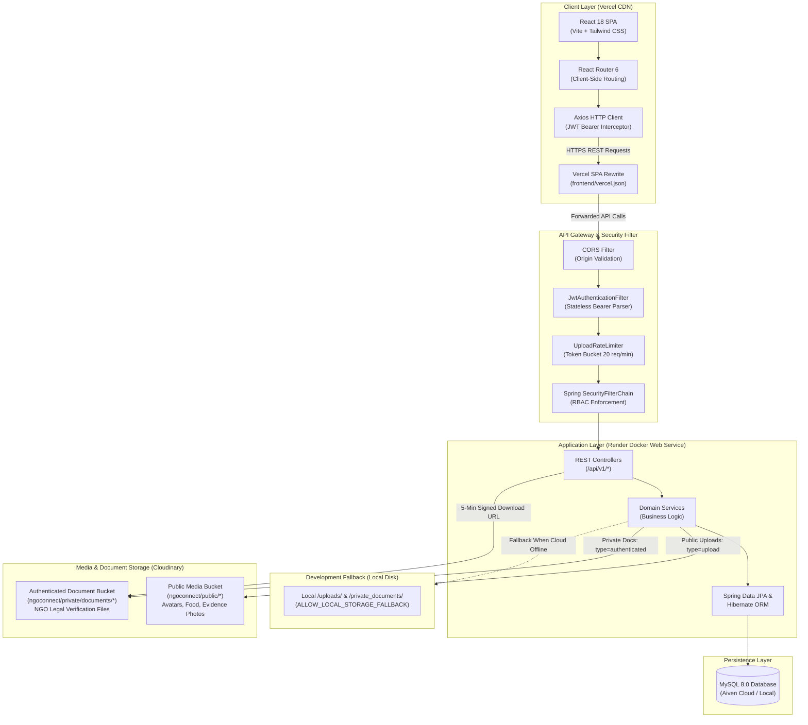

---

## Application Screenshots & Interface Walkthrough

### Home

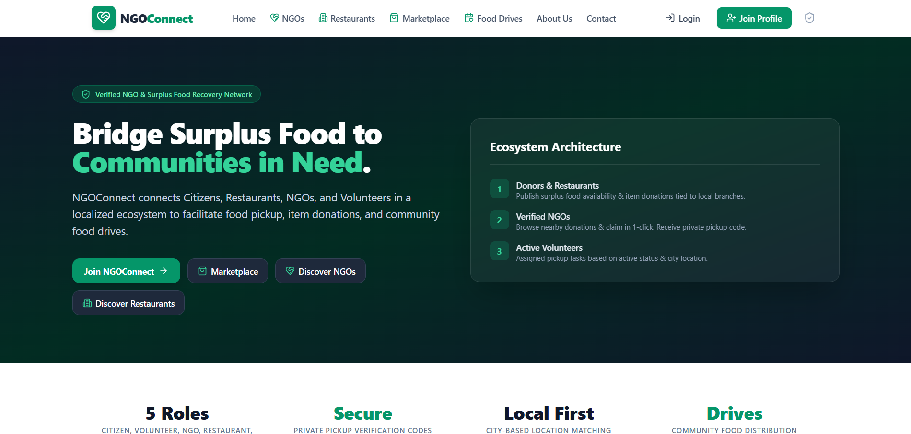
*Public landing page presenting the core mission, multi-role ecosystem architecture, and direct navigation into the marketplace and discovery directories.*

---

### Role-Based Dashboards

#### Citizen Dashboard
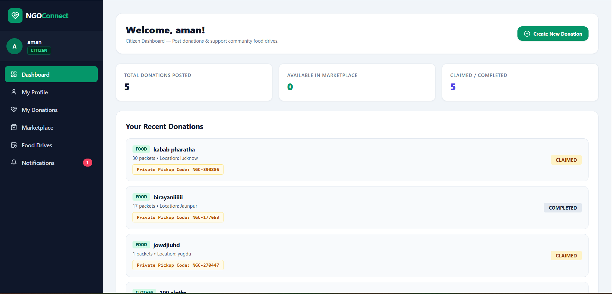
*Citizen donor console displaying total donations posted, active marketplace availability, recent donation history, and private pickup verification codes.*

#### Restaurant Dashboard
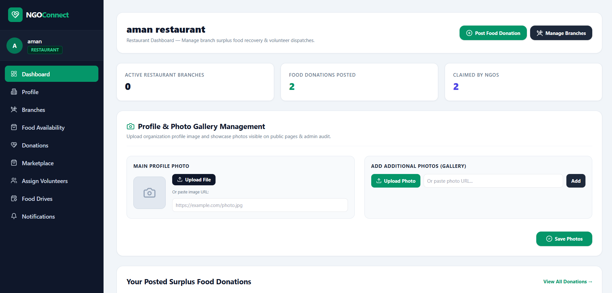
*Restaurant partner console showing surplus donation counts, branch oversight, and profile/gallery management for public discovery.*

#### NGO Dashboard
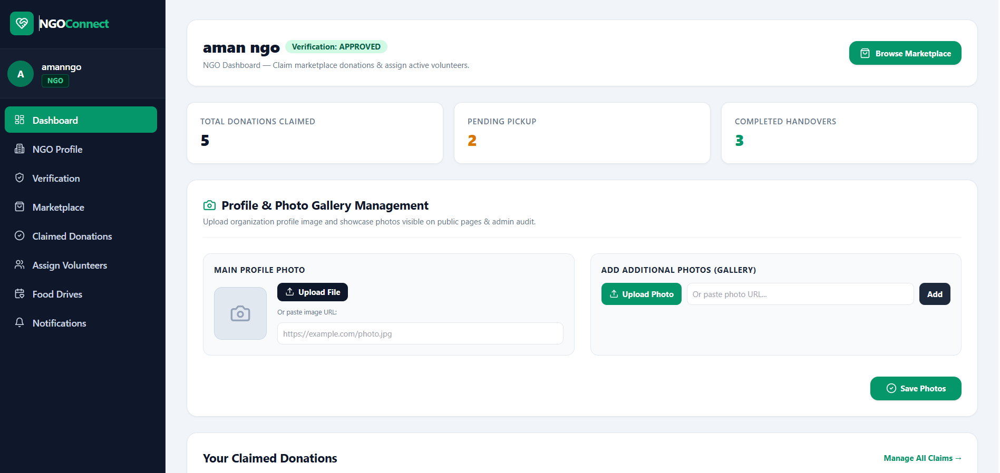
*NGO operations hub displaying approval status, claimed donation counts, pending pickups, completed handovers, and photo gallery management.*

#### Volunteer Dashboard
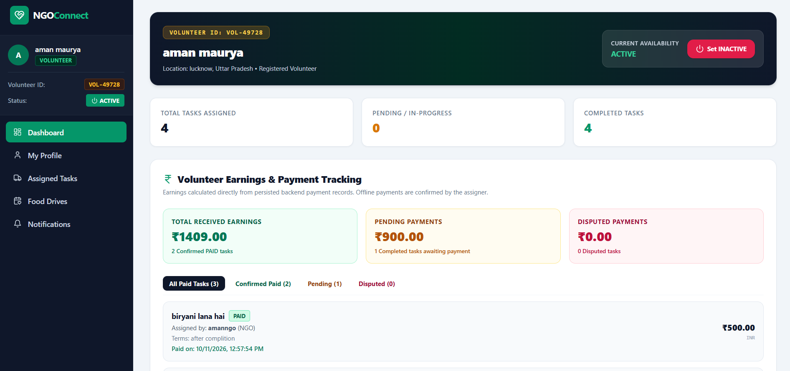
*Volunteer portal featuring availability controls (Active/Inactive), assigned task counts, and a financial earnings/stipend ledger with payment status breakdowns.*

#### Admin Dashboard
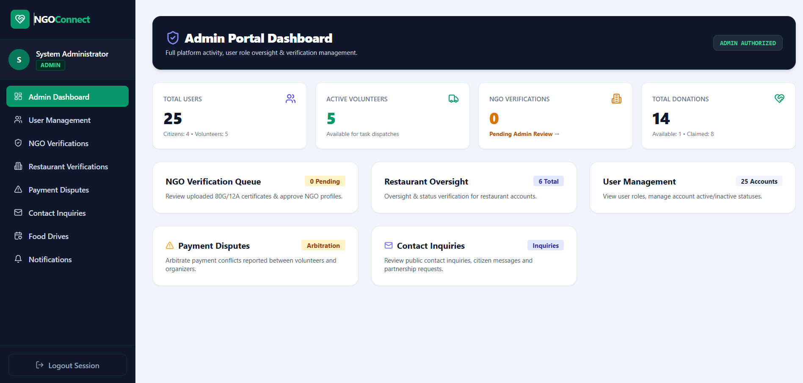
*Administrative command center tracking platform metrics (users, active volunteers, total donations) alongside queues for NGO verification, restaurant oversight, user management, payment arbitration, and contact inquiries.*

---

### Restaurants & NGOs

#### Discover Verified Restaurants
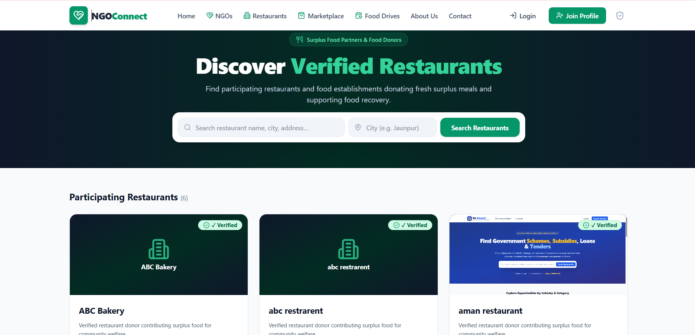
*Public restaurant directory with keyword/city search filters and verified donor profile cards.*

#### Discover Verified NGOs
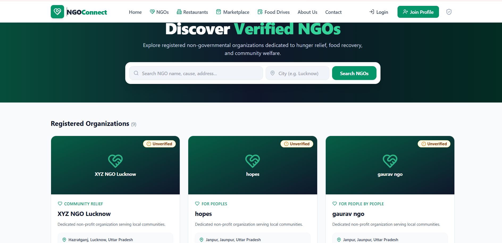
*Public NGO discovery directory with cause and city search filters, verification status badges, and local address listings.*

---

### Donation Marketplace

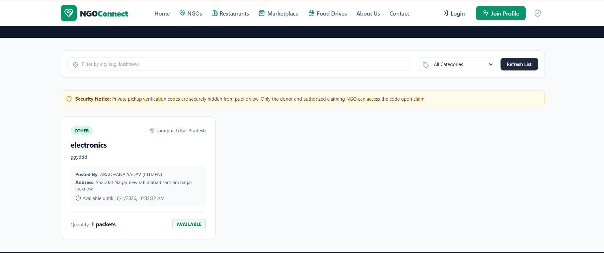
*Surplus donation marketplace featuring category and city filters, active item cards with portion quantities, and security notices indicating that private pickup verification codes remain protected until claim.*

---

### Community Food Drives

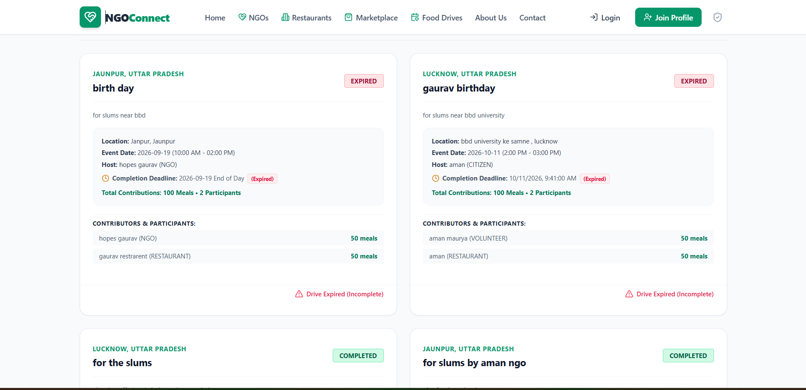
*Community food drive event cards highlighting event dates, host organizations, meal contribution counts, participant rosters, and completion/expiry statuses.*

---

## Technology Stack

### Frontend
- **Core Library**: React 18 (`react`, `react-dom`)
- **Build Engine & Dev Server**: Vite 5
- **Styling**: Tailwind CSS 3.4 with Autoprefixer and PostCSS
- **Routing**: React Router 6 (`react-router-dom`)
- **HTTP Client**: Axios with Bearer token request interceptor
- **Icons**: Lucide React

### Backend
- **Framework**: Spring Boot 3.3 (Spring MVC, Spring Security, Spring Data JPA)
- **Language / Runtime**: Java 17+ (tested through OpenJDK 25)
- **Security & Tokens**: Stateless JWT via JJWT (`io.jsonwebtoken:jjwt-api:0.12.5`)
- **Password Hashing**: BCrypt (`BCryptPasswordEncoder`)
- **Object Storage SDK**: Cloudinary Java SDK (`com.cloudinary:cloudinary-http44:1.38.0`)
- **Data Validation**: Jakarta Validation API with Hibernate Validator
- **Boilerplate Reduction**: Project Lombok
- **Build Tool**: Apache Maven 3.8+

### Database & Persistence
- **Production Database**: MySQL 8.0+ (InnoDB engine, UTF-8 multi-byte encoding)
- **Automated Test Database**: H2 In-Memory Database (`jdbc:h2:mem:ngoconnect_test`)
- **Database Migrations**: SQL migration scripts (`database/migrations/V1__initial_schema.sql`, `V2__reconcile_schema.sql`)

### Cloud Storage & Hosting
- **Media & Document Storage**: Cloudinary (Public Image CDN & Authenticated Signed Asset Storage)
- **Frontend Hosting**: Vercel Edge Network
- **Backend Hosting**: Render Web Service (Alpine Linux JRE Container)
- **Containerization**: Docker (multi-stage Maven build) & Docker Compose

---

## Security Architecture & Access Control

NGOConnect enforces industry-standard application security patterns across its backend and frontend:

### 1. Stateless JWT Authentication
- Authentication is handled statelessly via signed JSON Web Tokens (HMAC-SHA256, minimum 256-bit secret key).
- Standard transport requires client requests to include the token in the HTTP `Authorization` header:
  ```http
  Authorization: Bearer <jwt-token>
  ```
- **Query Parameter Deprecation**: Token parsing via query string parameters (`?token=`) has been explicitly eliminated from the `JwtAuthenticationFilter` to prevent credentials from leaking through browser histories, server access logs, and HTTP `Referer` headers.

### 2. Password Hashing & Credential Safety
- All user passwords are encrypted using BCrypt (`BCryptPasswordEncoder`) before persistence. Plaintext passwords are never logged, cached, or returned in API responses.

### 3. Role-Based Access Control (RBAC)
- Endpoint access is governed declaratively via `@PreAuthorize("hasRole('...')")` and programmatically through Spring Security's `SecurityFilterChain`.
- Public endpoints (`/api/v1/auth/**`, `/api/v1/ngos/public/**`, `/api/v1/restaurants/public/**`, `/api/v1/donations/marketplace/**`, `/api/v1/food-drives/**`, `/api/v1/contact`) are accessible unauthenticated, while administrative endpoints (`/api/v1/admin/**`) strictly mandate `ROLE_ADMIN`.

### 4. Upload Protection & Rate Limiting
- **Rate Limiting**: An in-memory token bucket rate limiter (`UploadRateLimiter`) restricts uploads to **20 requests per minute per authenticated user**, mitigating storage exhaustion and denial-of-service risks.
- **Payload Validation**: Strict 5MB file-size limits, MIME type verification (`image/jpeg`, `image/png`, `image/webp`, and `application/pdf`), extension whitelisting, and path traversal sanitization (`..` stripping).

### 5. Idempotent Initial Administrator Provisioning
- The application automatically verifies on startup whether any administrator account exists in the database.
- If an admin user already exists, environment variables (`INITIAL_ADMIN_*`) are completely ignored, guaranteeing that existing administrator profiles and passwords are never overwritten or reset upon server restart.

---

## Cloudinary Media & Document Storage

NGOConnect cleanly separates public media assets from confidential organization verification documents:

```
+------------------------------------------------------------------------+
|                        NGOConnect Storage Flow                         |
+----------------------------------+-------------------------------------+
|      Public Media Assets         |   Private Verification Documents    |
|  (Profile photos, food drives,   | (NGO 80G/12A, legal certificates,   |
|       donation evidence)         |        government identity)         |
+----------------------------------┼-------------------------------------+
|  Endpoint: POST /api/v1/upload   |  Endpoint: POST /api/v1/ngos/       |
|                                  |  verification-documents/upload      |
|  Storage: ngoconnect/public/*    |  Storage: ngoconnect/private/docs/* |
|  Cloudinary Type: 'upload'       |  Cloudinary Type: 'authenticated'   |
|  Access: Direct Public CDN HTTPS |  Access: Inaccessible via public CDN|
|  Delivery: Direct secure_url     |  Delivery: 5-minute signed URL or   |
|            from Cloudinary CDN   |  authenticated streaming proxy      |
+----------------------------------+-------------------------------------┘
```

### Public Image Storage
- Handled by `POST /api/v1/upload`.
- Uploads images as standard assets to Cloudinary under `ngoconnect/public/`.
- Returns an immutable HTTPS URL for avatars, restaurant branch photos, food donation images, and food drive evidence.

### Private Legal Verification Documents
- Handled by `POST /api/v1/ngos/verification-documents/upload`.
- Restricted to verified NGO accounts.
- Uploads documents (PDF, JPG, PNG, WEBP up to 5MB) as **`type: "authenticated"`** assets under `ngoconnect/private/documents/`.
- Assets uploaded under `type: "authenticated"` are blocked from public CDN access and return HTTP 401/404 if accessed directly without authorization.
- **Expiring Signed URL Delivery**: When an authorized NGO owner or Administrator requests document inspection via `GET /api/v1/ngos/verification-documents/{id}/view-url`, the backend uses Cloudinary's cryptographic `privateDownload()` API to generate an expiring URL with:
  - Strict 5-minute expiration timestamp (`expires_at = currentTime + 300`).
  - Cryptographic signature component (`s--<signature>--`).
  - Strict validation ensuring that public `/upload/` assets cannot be spoofed through the private endpoint.
- **Proxy Streaming Fallback**: Alternatively, `GET /api/v1/ngos/verification-documents/{id}/file` allows authorized users to stream the document binary directly through the backend without third-party redirects.

### Local Storage Fallback Mode
- Controlled via `ALLOW_LOCAL_STORAGE_FALLBACK` (`true` for offline development/testing; `false` in production).
- When Cloudinary credentials are omitted in development, files are saved locally to `backend/uploads/` and `backend/private_documents/`.
- In production, local storage fallback is disabled to prevent silent ephemeral storage loss across container restarts.

---

## Local Installation & Setup

### Prerequisites
Before running NGOConnect locally, ensure the following are installed:
- **Java Development Kit (JDK)**: Version 17 or higher (compatible through Java 25)
- **Node.js**: Version 18.x or higher (with npm)
- **Apache Maven**: Version 3.8.x or higher
- **MySQL Server**: Version 8.0 or higher
- **Git**

---

### Step 1: Clone the Repository
```bash
git clone https://github.com/gauravto312-wq/ngoconnect.git
cd ngoconnect
```

---

### Step 2: Environment Configuration
Copy the configuration templates:

```bash
# Option A: Root environment template
cp .env.example .env

# Option B: Individual component templates
cp backend/.env.example backend/.env
cp frontend/.env.example frontend/.env
```

Edit your `.env` or `backend/.env` with your local database credentials and a secure 256-bit JWT secret.

---

### Step 3: Database Setup
1. Start your local MySQL service.
2. Create the database:
   ```sql
   CREATE DATABASE ngoconnect CHARACTER SET utf8mb4 COLLATE utf8mb4_unicode_ci;
   ```
3. Initialize the database schema:
   - Apply migrations from `database/migrations/V1__initial_schema.sql` and `database/migrations/V2__reconcile_schema.sql`, **OR**
   - Allow Spring Boot's Hibernate DDL (`ddl-auto: update`) to automatically generate and validate tables on first run.

---

### Step 4: Run the Backend (Spring Boot)
In a terminal window:
```bash
cd backend
mvn spring-boot:run
```
The REST API will initialize on `http://localhost:8080`.

---

### Step 5: Run the Frontend (React + Vite)
In a separate terminal window:
```bash
cd frontend
npm install
npm run dev
```
The React development server will start on `http://localhost:5173`.

---

### Step 6: (Alternative) Run Full Stack Concurrently
If you have configured Node.js and Maven in your global PATH, run both services from the repository root:
```bash
# Using Node runner
node start.js

# Or using PowerShell runner on Windows
.\start.ps1
```

---

## Environment Variables Configuration

The following table documents all environment variables supported across the project, based strictly on the repository's `.env.example` templates and `application.yml`:

| Variable Name | Component | Scope | Required / Optional | Safe Default / Example | Purpose |
| :--- | :--- | :--- | :---: | :--- | :--- |
| `SPRING_DATASOURCE_URL` | Backend | Database | **Required** | `jdbc:mysql://localhost:3306/ngoconnect?useSSL=false&serverTimezone=UTC&allowPublicKeyRetrieval=true` | JDBC connection URL for MySQL database. |
| `SPRING_DATASOURCE_USERNAME` | Backend | Database | **Required** | `root` | Database user account name. |
| `SPRING_DATASOURCE_PASSWORD` | Backend | Database | Optional | *(empty)* | Database user account password. |
| `JWT_SECRET` | Backend | Security | **Required** | `your_jwt_secret_key_minimum_256_bits_long` | 256-bit HMAC-SHA secret key for JWT signing. |
| `PORT` | Backend | Server | Optional | `8080` | HTTP listening port for Spring Boot. |
| `FRONTEND_URL` | Backend | Security | Optional | `http://localhost:5173` | Allowed CORS origin(s). Supports comma-separated origins. |
| `INITIAL_ADMIN_EMAIL` | Backend | Bootstrap | Optional | `admin@ngoconnect.org` | Initial admin email (evaluated only if no admin exists). |
| `INITIAL_ADMIN_PASSWORD` | Backend | Bootstrap | Optional | `your_secure_admin_password` | Initial admin password (min 8 characters). |
| `INITIAL_ADMIN_NAME` | Backend | Bootstrap | Optional | `System Administrator` | Initial admin display name. |
| `INITIAL_ADMIN_PHONE` | Backend | Bootstrap | Optional | `9999999999` | Initial admin contact phone. |
| `CLOUDINARY_CLOUD_NAME` | Backend | Storage | Optional* | `your_cloud_name` | Cloudinary account cloud name. (*Required for persistent media). |
| `CLOUDINARY_API_KEY` | Backend | Storage | Optional* | `your_api_key` | Cloudinary account API key. (*Required for persistent media). |
| `CLOUDINARY_API_SECRET` | Backend | Storage | Optional* | `your_api_secret` | Cloudinary account API secret. (*Required for persistent media). |
| `ALLOW_LOCAL_STORAGE_FALLBACK` | Backend | Storage | Optional | `false` | Enable local disk fallback when Cloudinary is unconfigured. |
| `UPLOAD_DIR` | Backend | Storage | Optional | `uploads` | Local directory path for ephemeral file uploads. |
| `VITE_API_BASE_URL` | Frontend | Networking | Optional | `/api/v1` | REST API base URL path or remote backend origin. |
| `VITE_BACKEND_URL` | Frontend | Networking | Optional | `http://localhost:8080` | Remote backend origin for resolving backend-hosted assets. |

---

## Automated Testing & Production Build

### Running Backend Tests
NGOConnect includes an automated JUnit 5 / Spring Boot test suite covering authentication, RBAC, donation workflows, verification lifecycles, and Cloudinary security.

Tests execute against an isolated in-memory H2 database (`jdbc:h2:mem:ngoconnect_test`) configured in `application-test.yml`, ensuring local development databases are never modified:

```bash
cd backend
mvn test
```

### Building the Frontend for Production
To bundle and optimize the React frontend application:

```bash
cd frontend
npm run build
```

Production static assets (minified JS, CSS, and HTML entry point) are emitted to `frontend/dist/`.

---

## Containerization & Cloud Deployment

### 1. Docker Build & Local Compose

NGOConnect includes a multi-stage production Dockerfile (`backend/Dockerfile`) utilizing an Eclipse Temurin 17 JRE Alpine base image and executing under a non-root user (`appuser:appgroup`).

#### Build the Backend Container Locally:
```bash
# Run from repository root
docker build -f backend/Dockerfile -t ngoconnect-backend:1.0.0 .
```

#### Run with Docker Compose:
```bash
# Run backend service with container port mapping (8081 -> 8080)
docker compose -f backend/compose.yaml up -d
```

---

### 2. Render Web Service Deployment (Backend)
The backend is configured for deployment on Render as a Docker Web Service:
- **Environment**: Docker
- **Root Directory**: `.` *(leave blank in Render Dashboard to use repository root context)*
- **Dockerfile Path**: `backend/Dockerfile`
- **Port**: `8080` (Render dynamically assigns `PORT`)
- **Environment Variables**: Configure `SPRING_DATASOURCE_URL`, `SPRING_DATASOURCE_USERNAME`, `SPRING_DATASOURCE_PASSWORD`, `JWT_SECRET`, `FRONTEND_URL`, `CLOUDINARY_CLOUD_NAME`, `CLOUDINARY_API_KEY`, and `CLOUDINARY_API_SECRET` in the Render Dashboard.

---

### 3. Vercel Edge Deployment (Frontend)
The React SPA is deployed on Vercel with single-page application rewrites:
- **Framework Preset**: Vite
- **Root Directory**: `frontend`
- **Build Command**: `npm run build` (or `vite build`)
- **Output Directory**: `dist`
- **SPA Rewrites Configuration (`frontend/vercel.json`)**:
  ```json
  {
    "$schema": "https://openapi.vercel.sh/vercel.json",
    "rewrites": [
      {
        "source": "/((?!api/|assets/|uploads/).*)",
        "destination": "/index.html"
      }
    ]
  }
  ```
  *This configuration transparently rewrites client-side React Router navigation (e.g., `/restaurants`, `/food-drives`, `/marketplace`) to `/index.html` upon browser refresh, while strictly preserving static asset paths (`/assets/*`) and API endpoints.*

---

## Repository Directory Structure

```text
ngoconnect/
+-- .env.example                     # Root environment variables placeholder template
+-- .gitignore                       # Global Git exclusions (credentials, builds, uploads)
+-- package.json                     # Root package configuration (local run script)
+-- README.md                        # Project documentation and landing page
+-- start.js                         # Concurrent local runner script (Node.js)
+-- start.ps1                        # Concurrent local runner script (PowerShell)
+-- TEST_REPORT.md                   # Automated testing and quality assurance report
|
+-- backend/                         # Spring Boot 3 Backend Application
|   +-- .dockerignore                # Docker build exclusions
|   +-- .env.example                 # Backend environment variable template
|   +-- compose.yaml                 # Docker Compose service definition
|   +-- Dockerfile                   # Multi-stage Dockerfile (Temurin 17 Alpine)
|   +-- pom.xml                      # Maven project definition and dependencies
|   +-- src/
|       +-- main/
|       |   +-- java/com/ngoconnect/
|       |   |   +-- config/          # CORS, rate limiting, and Cloudinary beans
|       |   |   +-- controller/      # REST API controllers (/api/v1/*)
|       |   |   +-- dto/             # Data transfer objects and request validation
|       |   |   +-- entity/          # JPA entities (User, Role, Donation, Task, etc.)
|       |   |   +-- exception/       # Global exception handlers and error payloads
|       |   |   +-- repository/      # Spring Data JPA repositories
|       |   |   +-- security/        # JWT filter, UserPrincipal, and SecurityConfig
|       |   |   +-- service/         # Domain business logic and Cloudinary service
|       |   |   +-- NGOConnectApplication.java # Spring Boot main entry point & seeder
|       |   +-- resources/
|       |       +-- application.yml  # Application properties and environment bindings
|       +-- test/
|           +-- java/com/ngoconnect/ # JUnit 5 and Spring Boot integration test suites
|           +-- resources/
|               +-- application-test.yml # In-memory H2 test configuration
|
+-- database/                        # Database Schema & Migrations
|   +-- migrations/
|       +-- V1__initial_schema.sql   # Initial schema migration
|       +-- V2__reconcile_schema.sql # Schema reconciliation migration
|
+-- frontend/                        # React 18 + Vite Frontend Application
    +-- .env.example                 # Frontend environment variable template
    +-- index.html                   # HTML5 entry template
    +-- package.json                 # Frontend dependencies and build scripts
    +-- postcss.config.js            # PostCSS configuration
    +-- tailwind.config.js           # Tailwind CSS theme configuration
    +-- vercel.json                  # Vercel SPA rewrite rules (refresh 404 fix)
    +-- vite.config.js               # Vite build and local dev proxy configuration
    +-- src/
        +-- components/              # Reusable UI widgets and navigation layouts
        +-- context/                 # React Context providers (AuthContext)
        +-- pages/                   # Role-based dashboard pages & public views
        |   +-- admin/               # Administrator management views
        |   +-- citizen/             # Citizen donor views
        |   +-- ngo/                 # NGO operations and verification views
        |   +-- restaurant/          # Restaurant branch and surplus views
        |   +-- shared/              # Shared views (FoodDrives, Notifications)
        |   +-- volunteer/           # Volunteer delivery and task views
        +-- services/                # Axios client and API integration modules
        +-- App.jsx                  # React Router routes and RBAC guards
        +-- index.css                # Tailwind directives and global styles
        +-- main.jsx                 # React root DOM mounting point
```

---

## Contributing

Contributions are welcome from developers, community organizers, and designers passionate about hunger relief and food waste reduction.

1. **Fork the Repository**: Create an independent fork on GitHub.
2. **Create a Feature Branch**:
   ```bash
   git checkout -b feature/your-feature-name
   ```
3. **Commit Your Changes**: Follow conventional commit guidelines (`feat: ...`, `fix: ...`, `docs: ...`).
4. **Run Verification**: Ensure all backend tests pass (`mvn test`) and the frontend builds cleanly (`npm run build`).
5. **Open a Pull Request**: Submit a clear PR describing your changes, motivation, and test verification.

---

## License Status

This repository does not currently include a formal open-source license file (such as MIT or Apache 2.0). All rights are reserved by the repository owner ([@gauravto312-wq](https://github.com/gauravto312-wq)). For inquiries regarding commercial usage, redistribution, or collaboration, please open an issue or contact the maintainer directly.

---

## Social Impact & Vision

Every day, communities throw away perfectly wholesome food while adjacent neighborhoods experience acute food poverty. The underlying cause is rarely an absolute shortage of resources -- it is an **information and coordination gap**.

**NGOConnect** demonstrates how modern cloud-native software engineering can solve grassroots social problems:
- **Empowering Citizens**: Transforming everyday surplus into direct local relief.
- **Supporting Local Food Businesses**: Giving restaurants a frictionless, verified channel to eliminate kitchen surplus responsibly.
- **Strengthening Grassroots NGOs**: Providing non-profits with digital logistics, volunteer dispatch tools, and transparent governance.
- **Mobilizing Volunteers**: Creating clear, verified, and safe pathways for citizens to serve their local communities.

Through verified technology and open collaboration, NGOConnect aims to make zero-hunger communities an achievable, everyday reality.
